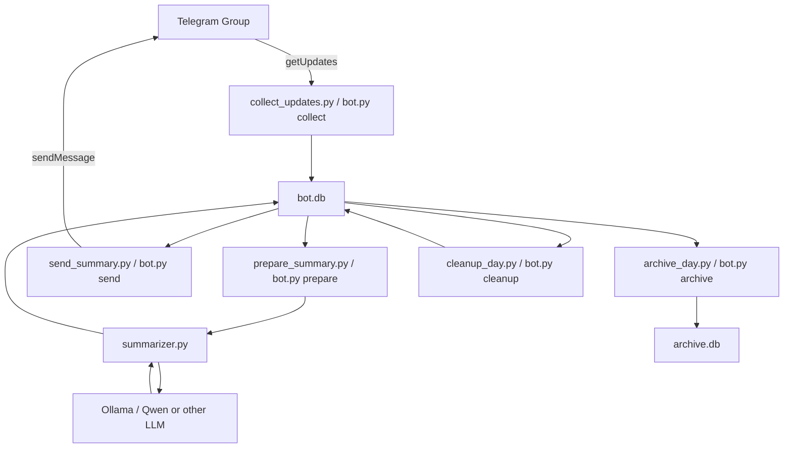

# Bot Architecture

## Верхнеуровневая архитектура

Бот работает не как постоянно запущенный процесс, а как набор cron-джоб, которые по расписанию запускают короткие Python-команды.

Основная идея:

1. `collect` забирает новые сообщения из Telegram и сохраняет их в рабочую базу `bot.db`.
2. `prepare` читает сообщения за текущий день, строит саммари через LLM и сохраняет готовый текст в `prepared_summaries`.
3. `send` публикует уже подготовленную сводку в группу.
4. `archive` копирует сегодняшние сообщения и саммари в отдельную архивную базу `archive.db`.
5. `cleanup` очищает рабочую базу `bot.db` от данных текущего дня, чтобы следующий день начинался с чистого рабочего контура.

## Верхнеуровневая схема

## Основные компоненты

### 1. Входная точка команд

Файл: `bot.py`

Отвечает только за маршрутизацию режимов:

- `collect`
- `prepare`
- `send`
- `archive`
- `cleanup`

То есть `bot.py` — это диспетчер, а не место бизнес-логики.

### 2. Сборщик сообщений

Файл: `collect_updates.py`

Что делает:

- создаёт `telegram.Bot`
- читает очередь `getUpdates`
- обрабатывает команды `/start`, `/enable_daily`, `/disable_daily`, `/summary`
- сохраняет обычные текстовые сообщения группы в `bot.db`
- хранит `last_update_id` в `bot_state`, чтобы не читать старые апдейты повторно

Ограничения:

- работает только в окне `10:00-20:59` по Москве
- сохраняет сообщения только из включённых чатов
- бот должен быть в группе и получать `getUpdates`

### 3. Подготовка саммари

Файл: `prepare_summary.py`

Что делает:

- читает список включённых чатов
- для каждого чата вызывает `build_summary_for_chat(...)`
- сохраняет готовый текст сводки в таблицу `prepared_summaries`
- логирует, через какой LLM-провайдер и модель была собрана сводка

### 4. Построение сводки

Файл: `summarizer.py`

Это центральный слой логики саммари.

Что внутри:

- построение transcript сообщений за день
- выбор самого активного участника по числу символов
- попытка получить структурированный JSON от LLM
- fallback на эвристику, если LLM не ответил или ответил плохо
- защита от мусорных тем и общих фраз
- repair-прогон, если первичный LLM-ответ пришёл в неожиданном формате
- финальная сборка текста для публикации

Ключевая идея:

- сначала используем LLM
- если LLM ответил слабо или криво, не пускаем этот ответ в публикацию без проверки
- если нужно, чиним ответ отдельным repair-запросом
- если и это не помогло, используем эвристический fallback

### 5. Клиент LLM

Файл: `llm_clients.py`

Поддерживает:

- `ollama` / `qwen`
- `yandex`
- `gigachat`

Сейчас основной путь — локальный `Ollama` с моделью `qwen2.5:14b-instruct`.

Что делает:

- формирует HTTP-запрос к нужному провайдеру
- отправляет `system` и `user` prompt
- получает сырой ответ модели
- пишет отдельный лог в `logs/ollama.log`

### 6. Публикация сводки

Файл: `send_summary.py`

Что делает:

- читает `prepared_summaries` за текущую дату
- если готовой сводки нет, строит её на лету
- отправляет текст в Telegram через `sendMessage`
- после отправки вызывает `cleanup_old_data(...)` для старых хвостов

### 7. Архивация дня

Файлы:

- `archive_storage.py`
- `archive_day.py`

Что делает:

- копирует сегодняшние сообщения из `bot.db` в `archive.db`
- копирует сегодняшнюю prepared summary в `archive.db`
- не влияет на сегодняшнюю рабочую логику до момента очистки

### 8. Очистка рабочего дня

Файл: `cleanup_day.py`

Что делает:

- удаляет из `bot.db` сообщения текущего дня
- удаляет prepared summary текущего дня

Идея:

- `bot.db` — рабочая, короткоживущая база
- `archive.db` — историческая, долгоживущая база

## Базы данных

### Рабочая база: `bot.db`

Основные таблицы:

- `messages` — сообщения текущего рабочего контура
- `tracked_chats` — чаты, где включён бот
- `prepared_summaries` — готовые сводки на дату
- `bot_state` — служебное состояние, например `last_update_id`

### Архивная база: `archive.db`

Основные таблицы:

- `archived_messages` — архив сообщений по датам
- `archived_summaries` — архив итоговых сводок

## Поток данных по шагам

### Шаг 1. Сбор

`Telegram -> getUpdates -> collect_updates.py -> bot.db.messages`

### Шаг 2. Подготовка

`bot.db.messages -> summarizer.py -> llm_clients.py -> LLM -> summarizer.py -> bot.db.prepared_summaries`

### Шаг 3. Публикация

`bot.db.prepared_summaries -> send_summary.py -> Telegram sendMessage`

### Шаг 4. Архив

`bot.db.messages + bot.db.prepared_summaries -> archive.db`

### Шаг 5. Очистка

`cleanup_day.py -> удалить сегодняшние данные из bot.db`

## Актуальное расписание

Живое расписание:

- `0 10-20 * * *` — `collect`
- `40 20 * * *` — финальный `collect`
- `45 20 * * *` — `prepare`
- `0 21 * * *` — `send`
- `10 21 * * *` — `archive`
- `15 21 * * *` — `cleanup`

## Контур отказоустойчивости

### Если Telegram не дал новых сообщений

- `collect` завершается штатно
- просто не добавляются новые строки в `messages`

### Если LLM ответил плохо

- первичный JSON проверяется
- мусорные темы отсекаются
- возможен repair-прогон
- если и это не помогает, включается эвристический fallback

### Если `send` не нашёл prepared summary

- он умеет собрать сводку на лету

### Если архив ещё не запускался

- `archive.db` просто ещё не существует
- появится после первого `archive`

## Главные текущие слабые места

1. Telegram Bot API не умеет вычитать старую историю задним числом.
2. Качество LLM всё ещё зависит от дисциплины prompt и структуры ответа модели.
3. Если cron на машине срабатывает нестабильно, страдает вся цепочка.
4. Если BotFather privacy mode настроен неверно, бот может видеть не все сообщения.

## Что считать “нормальной работой” вечером

Нормальная цепочка дня:

1. сообщения накопились в `bot.db`
2. в `20:45` появилась новая запись в `prepared_summaries`
3. в `21:00` в `send.log` есть `Sent summary to chat`
4. в `21:10` появился `archive.db` или обновились записи в нём
5. в `21:15` сегодняшние сообщения исчезли из рабочей `bot.db`
