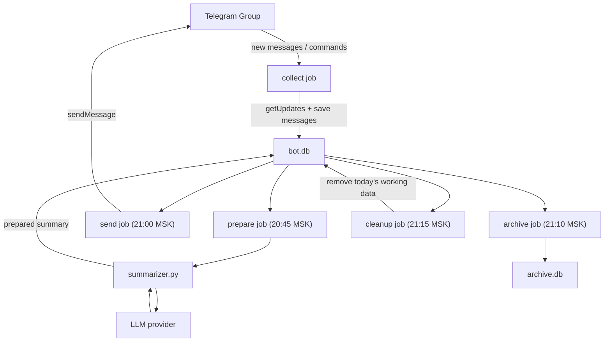

# Bot Flow Diagram

## Telegram Daily Summary Bot



## Daily Runtime Sequence

```mermaid
timeline
    title Daily Bot Schedule (MSK)
    10:00-20:00 : hourly collect jobs
    20:40 : final collect
    20:45 : prepare summary via LLM
    21:00 : send summary to Telegram group
    21:10 : archive today's messages and summary
    21:15 : clean today's working data from bot.db
```

## Component Meaning

- `collect job` pulls fresh Telegram updates and stores messages in `bot.db`
- `prepare job` reads today's messages and builds the summary
- `LLM provider` is currently local Ollama/Qwen, but can also be Yandex or GigaChat
- `send job` publishes the prepared summary to the Telegram group
- `archive job` copies today's messages and summary into `archive.db`
- `cleanup job` clears today's data from the working database after archiving

## Data Stores

- `bot.db` = working database for the current day
- `archive.db` = long-term history database
