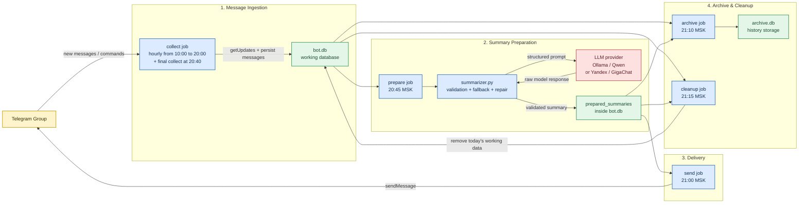

# Telegram Daily Summary Bot

## Presentation Diagram



## Executive Summary

- The bot is not a permanent online service; it is a scheduled workflow driven by cron jobs.
- `bot.db` is the live working database for the current day.
- `archive.db` is the long-term history database.
- The summary pipeline includes LLM validation, repair, and fallback logic before publication.
- Daily data is archived after publishing and then removed from the working database.

## Daily Schedule

```mermaid
timeline
    title Daily Bot Timeline (MSK)
    10:00-20:00 : hourly collect jobs
    20:40 : final collect
    20:45 : prepare summary via LLM
    21:00 : publish summary to Telegram
    21:10 : archive today's messages and summary
    21:15 : clean today's data from bot.db
```

## Reading Guide

- Yellow = Telegram input
- Blue = scheduled processing stages
- Red = LLM interaction
- Green = data storage
- Purple = message delivery back to Telegram
